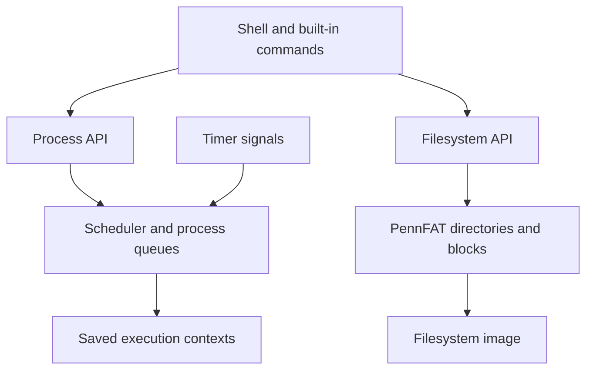

# PennOS

**A Unix-like operating system written in C: preemptive scheduling, process management, a shell, and a FAT-style filesystem.**

I built PennOS as part of a Penn CIS 548 team project. It brings the core pieces of an operating system together: deciding which process runs, switching execution contexts, tracking process state, handling signals, and persisting files. The instructional OS runs in a Linux userspace process using `ucontext` and timer signals.

## How it works

PennOS starts by mounting a filesystem image and creating the shell process. The shell invokes the OS process API to start and manage commands. A timer periodically transfers control to the scheduler, which selects a runnable process from its priority queues and restores that process's saved execution context.

File operations follow a separate path through PennFAT: file handles and directory entries map reads and writes onto blocks in the filesystem image. A standalone PennFAT utility lets that storage layer be explored independently of the OS shell.

## Inside the OS

| Subsystem | What it implements | Start reading |
| --- | --- | --- |
| Scheduler | Timer-driven preemption, context switching, three priority queues, blocking and wakeups | [scheduler.c](src/kernel/scheduler.c) |
| Processes | Spawn, wait, exit, kill, sleep, priority changes and process state | [process.c](src/os/process.c) |
| PennFAT | Filesystem images, block allocation, directories, file handles and read/write operations | [pennfat_fs.c](src/pennfat/pennfat_fs.c) · [pennfat_io.c](src/pennfat/pennfat_io.c) |
| Shell | Command execution, job control, signals and built-in commands | [job_control.c](src/shell/job_control.c) · [shell_builtins.c](src/os/shell_builtins.c) |
| Logging | Scheduling and process events for understanding execution | [logger.c](src/kernel/logger.c) |



## Build and explore

The supplied parser object targets Linux x86-64. Use the container on macOS or an ARM machine:

```sh
docker build --platform linux/amd64 -t penn-os .
docker run --rm -it --network none penn-os
```

Inside the container, create a filesystem using the standalone utility:

```sh
./bin/pennfat
```

At its prompt, enter `mkfs demo.fat 1 0`, then exit with Ctrl-D. Start the OS with:

```sh
./bin/penn-os demo.fat demo.log
```

Try the following commands in the PennOS shell:

| Command | What to observe |
| --- | --- |
| `echo hello` | A command runs through the OS shell and produces output |
| `ps` | The current process list, including PID, parent PID, priority and state |
| `sleep 2 &` | A process starts in the background |
| `jobs` | The shell's background-job state; run promptly before the sleep completes |
| `logout` | Exit the OS shell |

For a native Linux x86-64 build, install Clang, Make, the C development headers and Valgrind development headers, then run `make`.

## Context and credit

This is a historical team project from Spring 2021. Jai Ashar contributed to the original project; the repository's recorded authors also include Dominick C. Pastore, Nathan Korzekwa, Mytreyi Narayanaswamy and Prateek. Course-provided code and existing author notices remain attributed. This showcase presents the integrated team implementation.

The snapshot uses the `prepare-for-submission` branch, which contains the integrated shell, kernel and PennFAT source; the original default branch only held initial files. See [PROVENANCE.md](PROVENANCE.md) for the exact revision and publication changes.

## Validation

Build and smoke-test results are recorded in [VALIDATION.md](VALIDATION.md).
