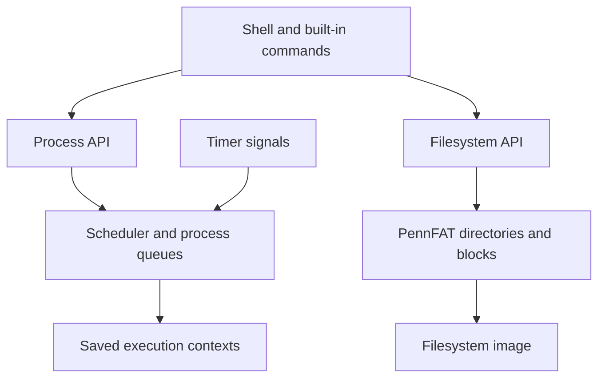
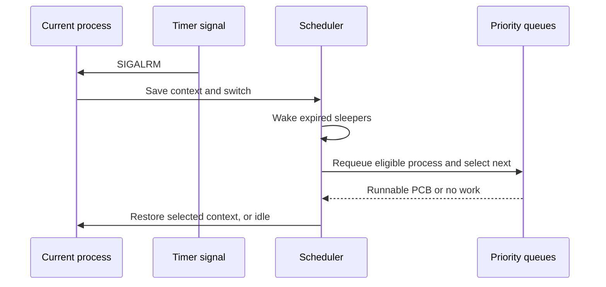

# PennOS

[](https://github.com/Jaiashar/penn-os/actions/workflows/ci.yml)

**A Unix-like operating system written in C: preemptive scheduling, process management, a shell, and a FAT-style filesystem.**

I built PennOS as part of a Penn CIS 548 team project. It brings the core pieces of an operating system together: deciding which process runs, switching execution contexts, tracking process state, handling signals, and persisting files. The instructional OS runs in a Linux userspace process using `ucontext` and timer signals.

## How it works

PennOS starts by mounting a filesystem image and creating the shell process. The shell invokes the OS process API to start and manage commands. A timer periodically transfers control to the scheduler, which selects a runnable process from its priority queues and restores that process's saved execution context.

File operations follow a separate path through PennFAT: file handles and directory entries map reads and writes onto blocks in the filesystem image. A standalone PennFAT utility lets that storage layer be explored independently of the OS shell.

## Inside the OS

| Subsystem | What it implements | Start reading |
| --- | --- | --- |
| Scheduler | Timer-driven preemption, context switching, three priority queues, blocking and wakeups | [scheduler.c](src/kernel/scheduler.c) |
| Processes | Spawn, wait, exit, kill, sleep, priority changes and process state | [process.c](src/os/process.c) |
| PennFAT | Filesystem images, block allocation, directories, file handles and read/write operations | [pennfat_fs.c](src/pennfat/pennfat_fs.c) · [pennfat_io.c](src/pennfat/pennfat_io.c) |
| Shell | Command execution, job control, signals and built-in commands | [job_control.c](src/shell/job_control.c) · [shell_builtins.c](src/os/shell_builtins.c) |
| Logging | Scheduling and process events for understanding execution | [logger.c](src/kernel/logger.c) |



## Process representation and scheduling

Each process has a [process control block](src/kernel/process_state.h) with a PID, parent pointer, execution context, priority, state, child queues, open-file table, and sleep deadline. `exec_ctx` contains the saved stack and register context. Each process has a 16 KiB context stack and 32 file-reference slots in this implementation.

The scheduler uses `setitimer(ITIMER_REAL)` with a 100,000 microsecond quantum. `SIGALRM` saves the current context with `swapcontext`; the scheduler selects the next process and restores it with `setcontext`. Priorities are `-1`, `0`, and `1`, with lower values receiving higher priority. When all three queues have work, the 19-entry rotation selects them 9, 6, and 4 times respectively. Separate rotations handle partially empty queues.



`RUNNING` means schedulable in the internal state model, so it covers more than the process currently executing. `BLOCKED` processes wait for a resource or event, `STOPPED` processes await continuation, and `ZOMBIE` processes have terminated but await cleanup. Keeping state separate from queue membership is central to understanding [process operations](src/os/process.c) and [scheduler transitions](src/kernel/scheduler.c).

## Filesystem representation

PennFAT stores its filesystem inside a host file. The [mounted filesystem structure](src/pennfat/pennfat_fs.h) retains the host file descriptor, a memory-mapped array of 16-bit FAT entries, block size, and data-block count. File handles and directory metadata sit above the raw block operations.


`raw_read` follows a block chain and can return a short read at its end. `raw_write` can allocate blocks and return a partial write when storage fills; its caller is responsible for file size and timestamp updates. This division makes the filesystem a useful place to study how low-level storage mechanics become file operations.

## Build and explore

The supplied parser object targets Linux x86-64. Use the container on macOS or an ARM machine:

```sh
docker build --platform linux/amd64 -t penn-os .
docker run --rm -it --network none penn-os
```

Inside the container, create a filesystem using the standalone utility:

```sh
./bin/pennfat
```

At its prompt, enter `mkfs demo.fat 1 0`, then exit with Ctrl-D. Start the OS with:

```sh
./bin/penn-os demo.fat demo.log
```

Try the following commands in the PennOS shell:

| Command | What to observe |
| --- | --- |
| `echo hello` | A command runs through the OS shell and produces output |
| `ps` | The current process list, including PID, parent PID, priority and state |
| `sleep 2 &` | A process starts in the background |
| `jobs` | The shell's background-job state; run promptly before the sleep completes |
| `logout` | Exit the OS shell |

For a native Linux x86-64 build, install Clang, Make, the C development headers and Valgrind development headers, then run `make`.

## Context and credit

This is a historical team project from Spring 2021. Jai Ashar contributed to the original project; the repository's recorded authors also include Dominick C. Pastore, Nathan Korzekwa, Mytreyi Narayanaswamy and Prateek. Course-provided code and existing author notices remain attributed. This showcase presents the integrated team implementation.

The snapshot uses the `prepare-for-submission` branch, which contains the integrated shell, kernel and PennFAT source; the original default branch only held initial files. See [PROVENANCE.md](PROVENANCE.md) for the exact revision and publication changes.

## Automated verification

The badge above reports the latest `main` push run. [The workflow](.github/workflows/ci.yml) builds the original C source in the Linux x86-64 container and runs [assertion-based smoke tests](tests/smoke.py) against the executables. Tests use a real pseudo-terminal with input echo disabled, so echoed commands cannot be mistaken for program output. Each run uses temporary files, bounded waits, and no network access inside the test container.

Run the same checks locally after building the image:

```sh
docker run --rm --network none --pids-limit 256 penn-os python3 tests/smoke.py
```

## Validation

Build and smoke-test results are recorded in [VALIDATION.md](VALIDATION.md).
